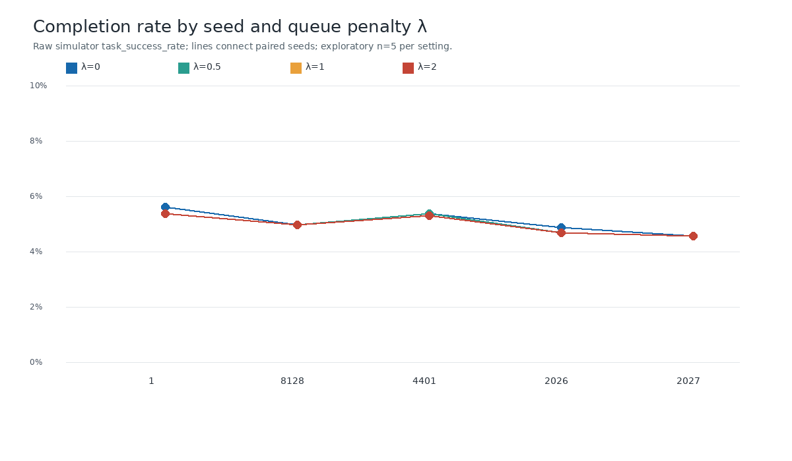
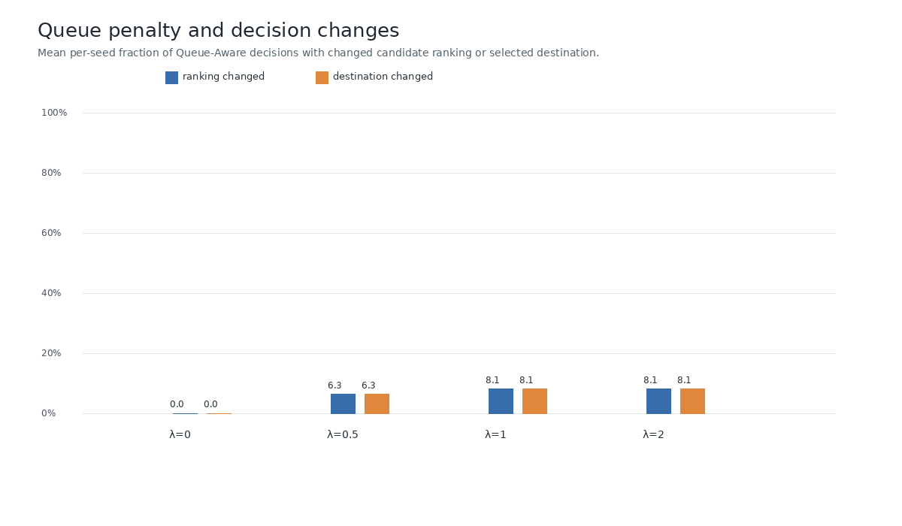
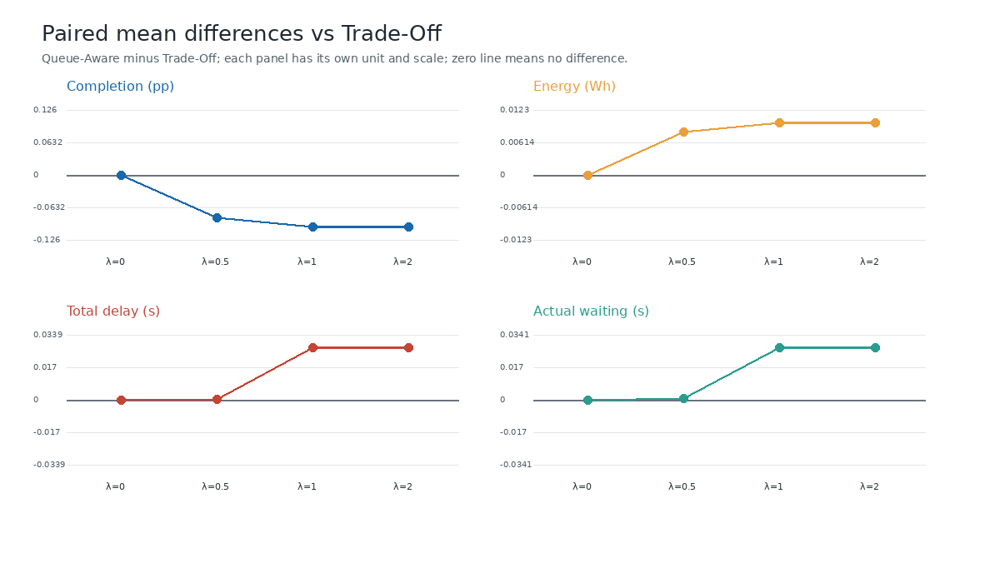

# Experiment Report

## 1. Objective

**Fakta / tujuan.** Menguji λ=0, 0.5, 1.0, 2.0 pada Queue-Aware dibanding Trade-Off untuk melihat efek penalty antrean pada ranking kandidat, destination, dan outcome simulator.

**Hipotesis yang diuji.** Kenaikan λ dapat membuat ranking/destination lebih sering berubah ketika queue estimate nonzero; belum tentu perubahan itu memperbaiki completion, energy, delay, atau actual waiting time.

## 2. Changes Made

- Tidak ada perubahan algoritma, konfigurasi baseline, formula estimator, atau source simulator untuk eksperimen ini. Source/instrumentasi yang dipakai berada pada commit `a5741757ac7cd6d833c8820ae462ad8a858d6d76` (working tree sebelum penambahan artefak bersih).
- Artefak eksperimen baru ditambahkan di folder ini: `matrix.json`, `execute_sensitivity_matrix.py`, `analyze_sensitivity.py`, log per run, manifest, raw run output, CSV, chart, dan report.
- `analyze_sensitivity.py` menghitung hasil langsung dari metrics dan trace CSV mentah; tidak mengubah metrik simulator.

## 3. Experiment Configuration

| Parameter | Nilai |
|---|---|
| Experiment ID | `20261103T224137Z_lambda_sensitivity` |
| Commit / simulator revision | repo `a5741757ac7cd6d833c8820ae462ad8a858d6d76`; PureEdgeSim `bcdd239fa301bd7164526dc47685058288c305ef` |
| Profile / devices / destinations | `paper-aligned-baseline`; 30 UE; 4 EDC; `EDGE_DC_ONLY` |
| Simulated duration | 5 s |
| Seeds | 1, 8128, 4401, 2026, 2027 |
| Methods | Trade-Off; Queue-Aware λ=0, 0.5, 1.0, 2.0 |
| Queue audit | task event trace dan queue decision audit aktif; destination audit dipertahankan |

Run dipasangkan berdasarkan seed. Semua konfigurasi workload/simulator pada pasangan cocok (profile, jumlah device, duration, destination, simulator revision/properties, file config SHA-256, dan seed); hanya method dan λ yang berbeda.

Command matriks persis per cell tercatat dalam [`commands_run.txt`](commands_run.txt). Contoh command yang dieksekusi:

```bash
PATH=/tmp/task-trace-bin:$PATH PAPER_TASK_EVENT_TRACE=1 RUNS_ROOT=results/experiments/20261103T224137Z_lambda_sensitivity/runs \
  /home/nasyikhqusyairy/Projects/repositories/queue-aware-task-offloading-simulation-baseline/run.sh \
  --profile paper-aligned-baseline --method queue-aware --devices 30 --duration-seconds 5 \
  --destination-config EDGE_DC_ONLY --seed 1 --queue-weight 0.5
```

## 4. Execution Status

- Pilot λ=0 dijalankan terlebih dahulu: Trade-Off seed 1 dan Queue-Aware λ=0 seed 1. Pilot lulus validasi ekuivalensi; matriks dilanjutkan. Rincian berada di [`PILOT_REPORT.md`](PILOT_REPORT.md) dan [`pilot_validation.json`](pilot_validation.json).
- Matriks lengkap: **25/25 run berhasil**, 0 gagal; seluruh proses exit 0 dan manifest/metrics tidak melaporkan validation errors. Status terinci di [`run_status.json`](run_status.json), ringkasan sel di [`run_level.csv`](run_level.csv), output mentah dan log ada di `runs/` dan log eksperimen.
- Setiap run menghasilkan 2.175 task yang di-dispatch. Jumlah per run memenuhi `generated = completed + failed + pending`.

## 5. Destination Selection Verification

**λ=0 ekuivalen dengan Trade-Off.** Pada kelima seed, Queue-Aware λ=0 memiliki assignment destination seluruh task, metrik simulator, ranking kandidat, selected candidate per keputusan, dan penalty (nol) yang identik dengan Trade-Off. Queue estimate tetap dicatat pada λ=0. Contoh seed 1: 56 dari 109 observasi kandidat bernilai nonzero, tetapi penalty nol dan tidak ada rank/destination decision berubah. Verifikasi semua seed ada di [`lambda0_equivalence_by_seed.csv`](lambda0_equivalence_by_seed.csv).

**Pengaruh λ.** Pada 384 keputusan Queue-Aware per λ, ranking berubah sebanyak:

| λ | Rank berubah | Destination decision berubah | Bagian keputusan berubah |
|---:|---:|---:|---:|
| 0 | 0/384 | 0/384 | 0% |
| 0.5 | 24/384 | 24/384 | 6.25% |
| 1.0 | 31/384 | 31/384 | 8.07% |
| 2.0 | 31/384 | 31/384 | 8.07% |

Dalam log audit, setiap perubahan ranking pada matriks ini juga mengubah selected candidate. λ=2.0 menghasilkan pola perubahan sama dengan λ=1.0 pada seed yang diuji: efek pemilihan tampak mencapai plateau dalam grid ini. Jumlah task yang tujuan akhirnya berbeda dari Trade-Off dapat lebih besar daripada jumlah policy call yang berubah karena sebuah placement dipakai untuk beberapa task; lihat `changed_task_destinations_vs_TO` di [`paired_by_seed_lambda.csv`](paired_by_seed_lambda.csv).

## 6. Results

Metrik outcome adalah mean ± sample SD antar lima seed; angka per-seed lengkap ada di [`run_level.csv`](run_level.csv). Completion rate adalah `successful_tasks / generated_tasks`. Failed berarti terminally failed dari metrics; pending adalah task yang belum terminal saat simulasi berakhir. Energy dilaporkan simulator dalam Wh dengan scope computing nodes (cloud, EDC, UE), tidak termasuk network energy. Delay dan actual waiting adalah average completed-task metrics simulator dalam detik; interpretasi terbatas pada task yang selesai.

| Metode | Completed | Failed | Pending | Completion rate | Energy (Wh) | Total delay (s) | Actual waiting (s) |
|---|---:|---:|---:|---:|---:|---:|---:|
| Trade-Off | 110.4 ± 9.13 | 1224.4 ± 55.94 | 840.2 ± 47.15 | 5.076% ± 0.420 pp | 3.0668 ± 0.0084 | 6.8514 ± 0.2051 | 1.2811 ± 0.2069 |
| Queue-Aware λ=0 | 110.4 ± 9.13 | 1224.4 ± 55.94 | 840.2 ± 47.15 | 5.076% ± 0.420 pp | 3.0668 ± 0.0084 | 6.8514 ± 0.2051 | 1.2811 ± 0.2069 |
| Queue-Aware λ=0.5 | 108.6 ± 8.32 | 1229.8 ± 46.91 | 836.6 ± 42.38 | 4.993% ± 0.383 pp | 3.0750 ± 0.0114 | 6.8517 ± 0.1991 | 1.2816 ± 0.2007 |
| Queue-Aware λ=1.0 | 108.2 ± 7.85 | 1231.0 ± 47.25 | 835.8 ± 42.74 | 4.975% ± 0.361 pp | 3.0766 ± 0.0066 | 6.8785 ± 0.1262 | 1.3084 ± 0.1277 |
| Queue-Aware λ=2.0 | 108.2 ± 7.85 | 1231.0 ± 47.25 | 835.8 ± 42.74 | 4.975% ± 0.361 pp | 3.0766 ± 0.0066 | 6.8785 ± 0.1262 | 1.3084 ± 0.1277 |

Rincian Queue-Aware per λ, agregat observasi seluruh seed:

| λ | Queue estimate min–max (s) | Observasi nonzero / total | Mean ranking/destination decisions berubah per seed |
|---:|---:|---:|---:|
| 0 | 0–5.630 | 258/492 | 0 / 0 |
| 0.5 | 0–5.255 | 258/492 | 4.8 / 4.8 |
| 1.0 | 0–4.505 | 263/497 | 6.2 / 6.2 |
| 2.0 | 0–4.505 | 263/497 | 6.2 / 6.2 |

Per-EDC task allocation untuk setiap seed × λ tersedia sebagai `dc1`–`dc4` di [`run_level.csv`](run_level.csv); semua empat EDC menerima task. Pada agregat seed, alokasi λ=0 identik Trade-Off (rata-rata 532, 647, 452, 544 task ke EDC 1–4). λ=0.5 menggeser rerata menjadi 514, 607, 476, 578; λ=1 dan λ=2 menjadi 514, 583, 476, 602. Alokasi merupakan destination decision untuk seluruh 2.175 task, bukan jumlah task selesai.







## 7. Paired Comparison and Statistical Results

Selisih didefinisikan Queue-Aware minus Trade-Off; CI 95% adalah paired t interval (df=4), dan p adalah exact two-sided paired sign-flip test dengan semua 32 kombinasi tanda. Nilai per seed serta mean, SD, CI, dan p untuk semua metrik berada di [`paired_by_seed_lambda.csv`](paired_by_seed_lambda.csv) dan [`paired_statistics.csv`](paired_statistics.csv).

| λ | Δ completion rate (pp), 95% CI | Δ energy (Wh), 95% CI | Δ total delay (s), 95% CI | Δ actual waiting (s), 95% CI |
|---:|---:|---:|---:|---:|
| 0 | 0.000 [0.000, 0.000], p=1.00 | 0.0000 [0.0000, 0.0000], p=1.00 | 0.0000 [0.0000, 0.0000], p=1.00 | 0.0000 [0.0000, 0.0000], p=1.00 |
| 0.5 | -0.083 [-0.225, 0.059], p=0.50 | +0.0081 [-0.0029, 0.0191], p=0.25 | +0.0004 [-0.0344, 0.0351], p=1.00 | +0.0005 [-0.0342, 0.0351], p=1.00 |
| 1.0 | -0.101 [-0.231, 0.029], p=0.25 | +0.0098 [-0.0023, 0.0219], p=0.125 | +0.0271 [-0.0895, 0.1438], p=0.688 | +0.0273 [-0.0894, 0.1439], p=0.688 |
| 2.0 | -0.101 [-0.231, 0.029], p=0.25 | +0.0098 [-0.0023, 0.0219], p=0.125 | +0.0271 [-0.0895, 0.1438], p=0.688 | +0.0273 [-0.0894, 0.1439], p=0.688 |

Untuk completion rate, p-value di atas menggunakan fraksi (bukan percentage point). Seluruh CI metrik outcome mencakup nol. Dengan hanya lima seed, sign-flip test sangat diskret dan daya inferensinya rendah; hasil ini eksploratif, bukan bukti kesetaraan atau keunggulan.

**Interpretasi.** λ positif mengubah sebagian keputusan dan menggeser distribusi keempat EDC. Namun rerata completion turun tipis, energy naik, dan delay/wait tidak menunjukkan penurunan konsisten. Pada λ=1/2, completion lebih rendah pada empat dari lima seed dan sama pada seed 2027; energy tidak lebih rendah pada seed mana pun. Tak ada satu nilai λ yang menunjukkan manfaat performa lintas metrik pada sampel ini.

## 8. Known Limitations

- Lima seed memberi estimasi variabilitas dan sign-flip p-value yang kasar; hasil tidak mendukung klaim superioritas maupun kesetaraan populasi.
- Metrik delay/wait dirata-ratakan hanya di antara task completed. Perubahan himpunan task yang selesai dapat mengubah komposisi sampel; metrik tersebut bukan delay semua task yang dihasilkan.
- Semua run adalah satu konfigurasi workload dan topologi. Hasil tidak menunjukkan perilaku pada pola imbalance lain.
- λ=1 dan λ=2 identik pada decision counts dan outcome untuk seed yang diuji; matriks ini tidak memetakan threshold/plateau secara kontinu.
- Failure/pending accounting mengikuti metric simulator saat ini; audit ini tidak memperbaiki lifecycle accounting.

## 9. Reproduction

Jalankan ulang seluruh 25 sel, menghasilkan run baru di output root yang sama:

```bash
PATH=/tmp/task-trace-bin:$PATH python3 results/experiments/20261103T224137Z_lambda_sensitivity/execute_sensitivity_matrix.py
```

Run baru diberi timestamp dan tidak menimpa direktori run selesai. Analisis artefak saat ini tanpa rerun:

```bash
python3 results/experiments/20261103T224137Z_lambda_sensitivity/analyze_sensitivity.py
```

Konfigurasi ada di `matrix.json`, manifest dan output mentah di `runs/<run_id>/`, CSV agregat di folder ini, dan PNG di `charts/`.

## 10. Recommended Next Step

Lanjutkan ke eksperimen **workload imbalance** dengan λ=0 sebagai kontrol dan λ=0.5 serta λ=1.0 sebagai kandidat (λ=2.0 belum memberi perubahan tambahan terhadap λ=1.0 pada data ini). Pertahankan pasangan seed, ukur imbalance per EDC yang benar-benar dikonfigurasi, dan tambah jumlah seed. Ini menguji apakah Queue-Aware membantu saat tekanan antrean terlokalisasi, alih-alih memilih λ terbaik dari matriks homogen saat ini.

## 11. Kesimpulan

1. **λ=0 ekuivalen dengan Trade-Off?** Ya, untuk kelima seed: seluruh assignment task, metrik, rank, pilihan kandidat, dan score penalty terverifikasi identik.
2. **Pengaruh λ pada destination selection?** λ=0 tidak mengubah pilihan. λ=0.5 mengubah 24/384 keputusan; λ=1.0 dan 2.0 mengubah 31/384 masing-masing. Lebih banyak task dapat terdampak karena satu placement berlaku untuk beberapa task.
3. **Ada λ dengan performa lebih baik?** Tidak terbukti. Completion rata-rata turun, energy naik, dan CI 95% berpasangan mencakup nol untuk metrik utama.
4. **Trade-off?** Ada pergeseran destination dan queue-informed decision, tetapi outcome menunjukkan completion cenderung turun dan energy cenderung naik; delay dan waiting rata-rata naik kecil pada λ=1/2, tanpa hasil yang meyakinkan secara statistik.
5. **Layak ke workload imbalance?** Ya sebagai eksperimen diagnostik lanjutan, bukan klaim peningkatan. Uji apakah konsentrasi queue pressure yang lebih tidak merata membuat perubahan destination berguna, dengan lebih banyak seed dan queue/allocation observability.

## Audit Checklist

- [PASS] Pilot dan 25-run matrix selesai (25/25, 0 gagal).
- [PASS] Expected manifest, raw trace, queue audit, destination audit, CSV, dan PNG tersedia.
- [PASS] Seed/configuration paired; konfigurasi hash dan simulator properties cocok untuk setiap pasangan.
- [PASS] λ=0 decision equivalence diperiksa pada kelima seed.
- [PASS] Queue estimate tercatat pada λ=0 dan λ positif; observasi nonzero muncul di seluruh λ-seed cells.
- [PASS] Statistik mean/SD, paired differences, 95% CI, dan exact sign-flip test direproduksi oleh skrip analisis.
- [INCONCLUSIVE] Efek performa yang stabil atau generalisasi ke beban lain; n=5 dan satu profil workload.
